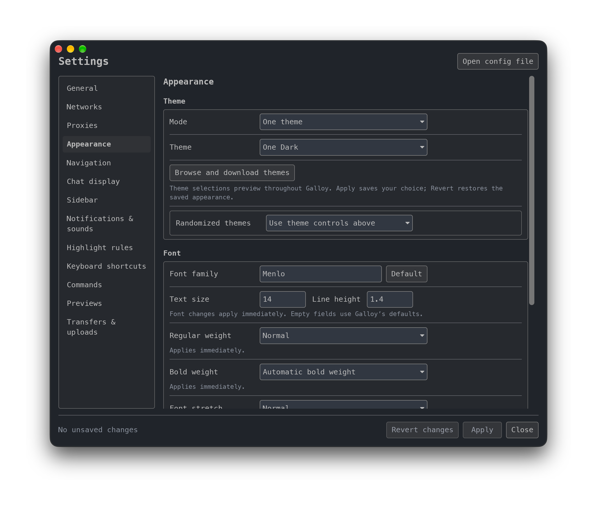

# Galloy


An IRC client with graphical settings, built on [Halloy](https://github.com/squidowl/halloy).

**Galloy is an unofficial, AI-assisted fork.** It adds a native Settings window
while following Halloy's design and configuration format. It is maintained
independently of the upstream Halloy project.

[Download the macOS preview](https://github.com/solid-pixel/galloy/releases)
· [Settings guide](docs/guides/settings-gui.md)
· [Report an issue](https://github.com/solid-pixel/galloy/issues)



## What Galloy adds

- **Graphical configuration:** edit networks, proxies, appearance, navigation,
  chat display, sidebar, notifications, highlights, shortcuts, commands,
  previews, transfers, uploads, and general preferences.
- **Live theme previews:** browse the Halloy community theme gallery and preview
  a selection across the app before saving. Choose separate light and dark
  themes to follow your system appearance.
- **Installed font pickers:** search your fonts and see each name rendered in
  its own face. Apply font changes without restarting.
- **Compact settings:** vertical navigation, grouped rows, controls sized for
  their contents, and a separate network list.
- **Configuration-aware saving:** validate changes before applying, retain
  other settings and TOML comments, and keep a backup of the previous file.
  The text-based Config Editor remains available.

See the [Settings guide](docs/guides/settings-gui.md) for behavior and limitations,
and the [field coverage checklist](docs/guides/settings-gui-coverage.md) for the
configuration options exposed in the GUI.

## Try the macOS preview

The current packaged preview is a universal macOS build for Apple silicon and
Intel. Downloads, source archives, checksums, and verification details are on the
[releases page](https://github.com/solid-pixel/galloy/releases).

1. Back up your existing `config.toml` and quit Halloy if it is running.
2. Download and open the Galloy disk image, then drag **Galloy** to **Applications**.
3. Launch Galloy and open **Settings** with **⌘,**, from the user menu, or from
   the welcome screen.
4. Make your changes and press **Apply** to save. **Revert changes** restores
   the saved configuration.

The macOS preview is signed ad hoc and **is not notarized by Apple**. macOS may
block its first launch; see the release notes for opening instructions.
Upstream Halloy packages from package managers and app stores do not include
Galloy's Settings GUI.

## Existing Halloy configurations

Galloy uses Halloy's existing `config.toml`, theme files, and default configuration
and history locations. It can open your existing setup without a migration.
Because the two apps share these locations, quit one before using the other.

Settings saves a `config.toml.settings-backup` beside the configuration file.
If another editor changes the file while Settings is open, applying is refused
until you reload the saved configuration. Some server changes require a
reconnection, and startup settings such as the renderer require a restart.
The GUI explains these cases.

To try Galloy with separate configuration and history, see the
[isolated configuration instructions](docs/guides/settings-gui.md#development)
using `HALLOY_PORTABLE_DIR`. The environment variable retains its Halloy name
for compatibility.

## Project status and AI assistance

Galloy is an experimental fork developed with assistance from AI coding agents.
The graphical settings and fork changes are AI-assisted work; the underlying
IRC client is the work of the Halloy project and its contributors.

Each prerelease documents the checks performed and any testing limitations.
Please report bugs and feature requests on the
[Galloy issue tracker](https://github.com/solid-pixel/galloy/issues), including
the release version and steps to reproduce. Remove passwords, tokens, and other
private details from any configuration excerpts or logs you share.

## Documentation and development

- [Settings guide](docs/guides/settings-gui.md): controls, saving behavior, and
  development commands.
- [Field coverage checklist](docs/guides/settings-gui-coverage.md): GUI coverage
  of the configuration schema.
- [Upstream Halloy documentation](https://halloy.chat): IRC usage and the shared
  configuration format.

With Rust installed, run from a checkout:

```sh
cargo run --profile ci
```

For Galloy contributions, open an issue or pull request on this fork.
For contributions to Halloy itself, follow
[Halloy's contributing guide](https://halloy.chat/contributing).

## IRC support

Galloy inherits Halloy's IRC client and IRCv3 support.

<details>
<summary>Supported IRCv3 capabilities</summary>

- [account-notify](https://ircv3.net/specs/extensions/account-notify)
- [away-notify](https://ircv3.net/specs/extensions/away-notify)
- [batch](https://ircv3.net/specs/extensions/batch)
- [bot mode](https://ircv3.net/specs/extensions/bot-mode)
- [cap-notify](https://ircv3.net/specs/extensions/capability-negotiation.html#cap-notify)
- [channel-context](https://ircv3.net/specs/client-tags/channel-context)
- [chathistory](https://ircv3.net/specs/extensions/chathistory)
- [chghost](https://ircv3.net/specs/extensions/chghost)
- [echo-message](https://ircv3.net/specs/extensions/echo-message)
- [extended-join](https://ircv3.net/specs/extensions/extended-join)
- [invite-notify](https://ircv3.net/specs/extensions/invite-notify)
- [labeled-response](https://ircv3.net/specs/extensions/labeled-response)
- [message-redaction](https://ircv3.net/specs/extensions/message-redaction)
- [message-tags](https://ircv3.net/specs/extensions/message-tags)
- [metadata](https://ircv3.net/specs/extensions/metadata)
  - `display-name`
  - `avatar`
  - `pronouns`
  - `homepage`
  - `color`
  - `status`
- [Monitor](https://ircv3.net/specs/extensions/monitor)
- [msgid](https://ircv3.net/specs/extensions/message-ids)
- [multi-prefix](https://ircv3.net/specs/extensions/multi-prefix)
- [multiline](https://ircv3.net/specs/extensions/multiline)
- [network-icon](https://ircv3.net/specs/extensions/network-icon)
- [no-implicit-names](https://ircv3.net/specs/extensions/no-implicit-names)
- [react](https://ircv3.net/specs/client-tags/react.html)
- [read-marker](https://ircv3.net/specs/extensions/read-marker)
- [reply](https://ircv3.net/specs/client-tags/reply)
- [sasl-3.1](https://ircv3.net/specs/extensions/sasl-3.1)
- [server-time](https://ircv3.net/specs/extensions/server-time)
- [setname](https://ircv3.net/specs/extensions/setname.html)
- [Standard Replies](https://ircv3.net/specs/extensions/standard-replies)
- [typing](https://ircv3.net/specs/client-tags/typing)
- [userhost-in-names](https://ircv3.net/specs/extensions/userhost-in-names)
- [`UTF8ONLY`](https://ircv3.net/specs/extensions/utf8-only)
- [`WHOX`](https://ircv3.net/specs/extensions/whox)
- [`soju.im/bouncer-networks`](https://soju.im/bouncer-networks)
- [`soju.im/filehost`](https://soju.im/filehost)

</details>

## Credits and license

Galloy builds on [Halloy](https://github.com/squidowl/halloy), created and
maintained by its upstream contributors, and the [Iced](https://github.com/iced-rs/iced)
GUI library. Galloy uses the [Blackberry bird icon](assets/galloy-blackberry.svg).
Halloy's original app icon is by Rune Seir.

Galloy and Halloy are licensed under **GPL-3.0-or-later**. See [LICENSE](LICENSE).
The source archive attached to each Galloy preview includes its packaging script
and build instructions.
