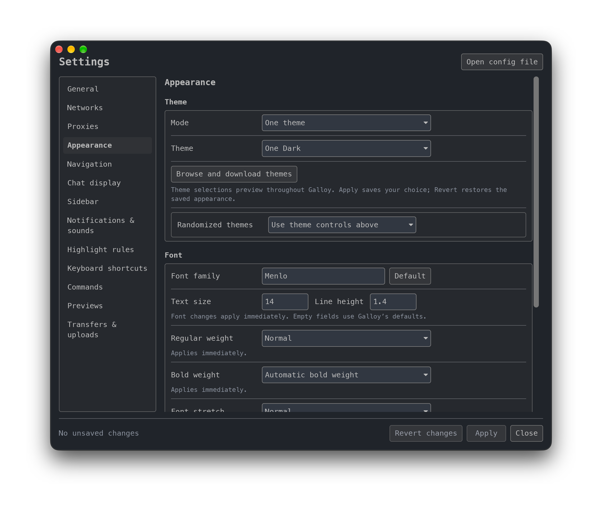

# Galloy

An IRC client with graphical settings, built on [Halloy](https://github.com/squidowl/halloy).
**Galloy is an unofficial, AI-assisted fork**, maintained independently of upstream.

[Download the macOS preview](https://github.com/solid-pixel/galloy/releases)
· [Settings guide](./guides/settings-gui.md)
· [Report an issue](https://github.com/solid-pixel/galloy/issues)

## Graphical settings

Configure networks, appearance, navigation, chat display, notifications,
shortcuts, and more in the native Settings window. Preview themes throughout
the app and choose installed fonts without restarting.

Start with [Getting started](./getting-started.md), or see the
[field coverage guide](./guides/settings-gui-coverage.md) for available controls.
The Config Editor and shared TOML configuration format remain available.

## Platforms and compatibility

Galloy builds for macOS, Windows, and Linux. Current packaged previews are
universal macOS builds for Apple silicon and Intel. They are signed ad hoc and
are not notarized by Apple. See [Installation](./installation.md) for downloads
and [Packaging and identity](./guides/galloy-packaging.md) for source builds.

Galloy shares Halloy's default configuration and history locations outside
Flatpak. Quit one before opening the other with shared data, or use
[portable mode](./guides/portable-mode.md) for separate data.

## Credits and license

Galloy builds on Halloy and the [Iced](https://github.com/iced-rs/iced) GUI library.
The IRC client is the work of Halloy's upstream contributors. The fork and
Settings GUI were developed with AI assistance.

Galloy is licensed under GPL-3.0-or-later. Source and build instructions are
included with each preview. See [Contributing](./contributing.md) and
[Get in touch](./get-in-touch.md) for this fork's contribution and support routes.

## IRCv3 Capabilities

Galloy inherits Halloy's IRC engine and IRCv3 support. Supported capabilities include:

- [account-notify](https://ircv3.net/specs/extensions/account-notify)
- [away-notify](https://ircv3.net/specs/extensions/away-notify)
- [batch](https://ircv3.net/specs/extensions/batch)
- [bot mode](https://ircv3.net/specs/extensions/bot-mode)
- [cap-notify](https://ircv3.net/specs/extensions/capability-negotiation.html#cap-notify)
- [channel-context](https://ircv3.net/specs/client-tags/channel-context)
- [chathistory](https://ircv3.net/specs/extensions/chathistory)
- [chghost](https://ircv3.net/specs/extensions/chghost)
- [echo-message](https://ircv3.net/specs/extensions/echo-message)
- [extended-join](https://ircv3.net/specs/extensions/extended-join)
- [invite-notify](https://ircv3.net/specs/extensions/invite-notify)
- [labeled-response](https://ircv3.net/specs/extensions/labeled-response)
- [message-redaction](https://ircv3.net/specs/extensions/message-redaction)
- [message-tags](https://ircv3.net/specs/extensions/message-tags)
- [metadata](https://ircv3.net/specs/extensions/metadata)
  - `display-name`
  - `avatar`
  - `pronouns`
  - `homepage`
  - `color`
  - `status`
- [Monitor](https://ircv3.net/specs/extensions/monitor)
- [msgid](https://ircv3.net/specs/extensions/message-ids)
- [multi-prefix](https://ircv3.net/specs/extensions/multi-prefix)
- [multiline](https://ircv3.net/specs/extensions/multiline)
- [network-icon](https://ircv3.net/specs/extensions/network-icon)
- [no-implicit-names](https://ircv3.net/specs/extensions/no-implicit-names)
- [react](https://ircv3.net/specs/client-tags/react.html)
- [read-marker](https://ircv3.net/specs/extensions/read-marker)
- [reply](https://ircv3.net/specs/client-tags/reply)
- [sasl-3.1](https://ircv3.net/specs/extensions/sasl-3.1)
- [server-time](https://ircv3.net/specs/extensions/server-time)
- [setname](https://ircv3.net/specs/extensions/setname.html)
- [Standard Replies](https://ircv3.net/specs/extensions/standard-replies)
- [typing](https://ircv3.net/specs/client-tags/typing)
- [userhost-in-names](https://ircv3.net/specs/extensions/userhost-in-names)
- [`UTF8ONLY`](https://ircv3.net/specs/extensions/utf8-only)
- [`WHOX`](https://ircv3.net/specs/extensions/whox)
- [`soju.im/bouncer-networks`](https://soju.im/bouncer-networks)
- [`soju.im/filehost`](https://soju.im/filehost)
